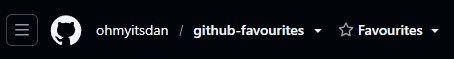
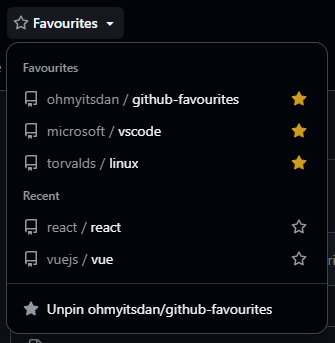

# GitHub Favourites

A userscript that adds a **Favourites ▾** dropdown to GitHub's header, right after the repo name, so your most-used repos are always one click away.

- **Favourites:** repos you've pinned, in the order you pinned them
- **Recent:** the last 10 repos you visited, tracked automatically
- **Pin / unpin** with the star on any row, or with "Pin owner/repo" at the bottom of the menu
- Styled with GitHub's own design tokens, so it matches light, dark and high-contrast themes
- Keeps working as you move around GitHub without full page loads

## Install

1. Install a userscript manager: [Violentmonkey](https://violentmonkey.github.io/) (recommended) or [Tampermonkey](https://www.tampermonkey.net/).
2. Open **[github-favourites.user.js](https://raw.githubusercontent.com/ohmyitsdan/github-favourites/main/github-favourites.user.js)**. Your userscript manager will offer to install it.
3. Reload GitHub.

Updates are picked up automatically by your userscript manager.

## Usage

Open any repo and click **Favourites ▾** next to its name.

| To… | Do this |
| --- | --- |
| Pin the repo you're on | Open the dropdown, then **Pin owner/repo** at the bottom |
| Pin or unpin any listed repo | Click the star on its row |
| Edit or reorder favourites in bulk | Userscript manager menu → **Edit favourites** (comma-separated `owner/repo` list) |
| Clear your recent repos | Userscript manager menu → **Clear recent repos** |
| Close the dropdown | Click anywhere else, or press <kbd>Esc</kbd> |

## Privacy

Your favourites and recent repos are stored by your userscript manager (`GM_setValue`) in your own browser. The script makes no network requests, needs no token and only runs on `github.com`.

## Compatibility

- Works with Violentmonkey and Tampermonkey. Greasemonkey 4+ isn't supported, because it doesn't provide the synchronous `GM_*` API.
- Built against GitHub's 2025–26 header. If GitHub changes its header markup the button may land in the wrong place; please [open an issue](https://github.com/ohmyitsdan/github-favourites/issues) with a screenshot.

## License

[MIT](LICENSE)
